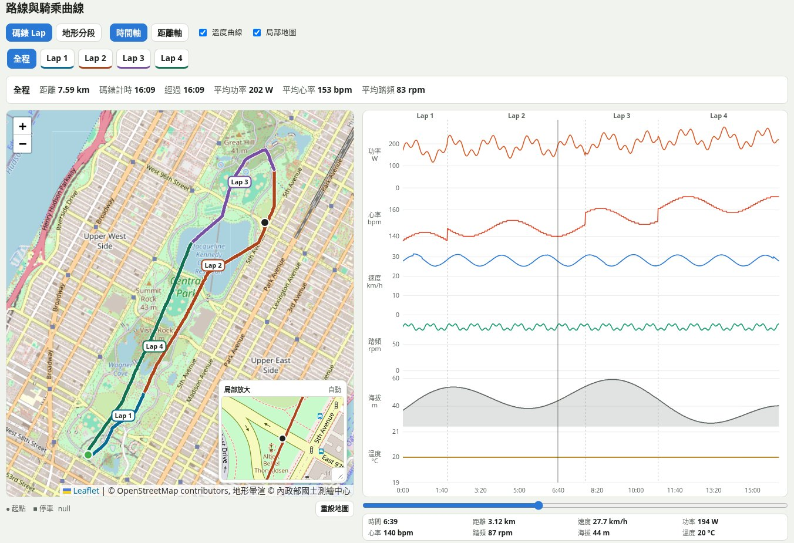
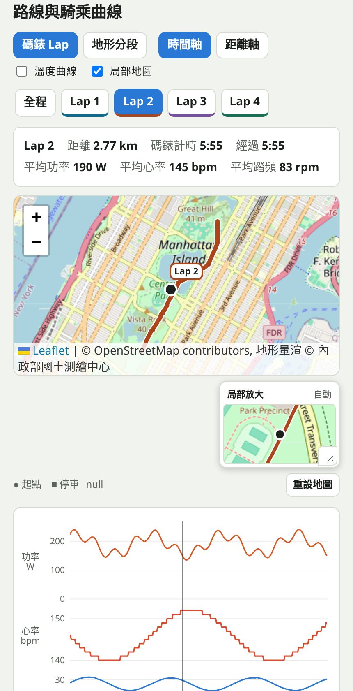
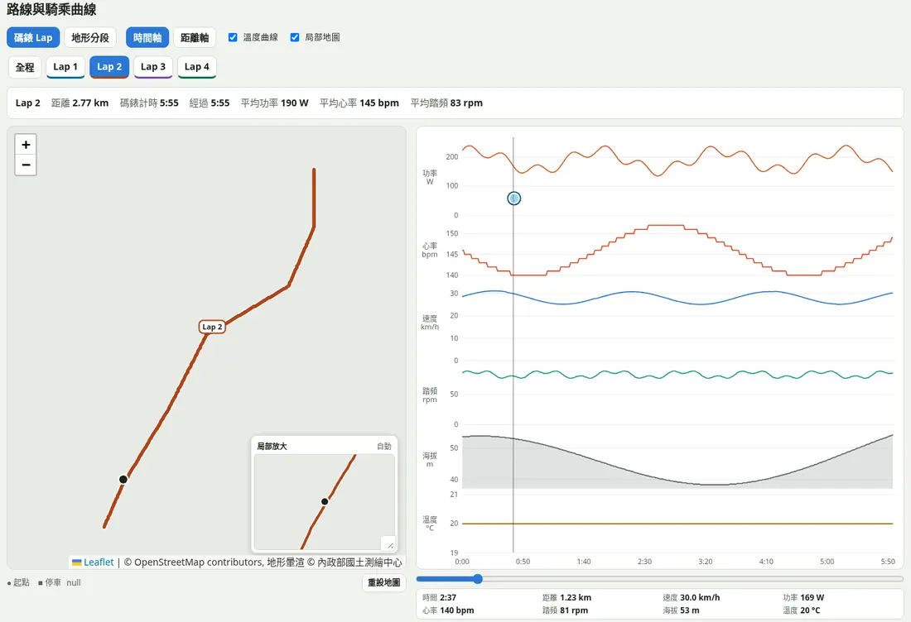
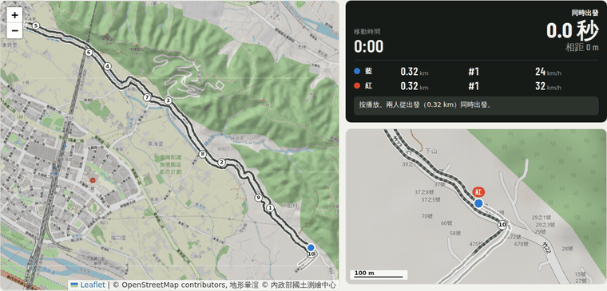

# 騎乘分析 2.0

**[開啟騎乘分析](https://evantilu.github.io/bike-visualization-and-analyses/?v=2.0.8)** · **[下載示範 FIT](https://evantilu.github.io/bike-visualization-and-analyses/docs/demo/sample-ride.fit)**

匯入碼錶的 **FIT** 或 Strava 的 **GPX**，在同一畫面對照路線、速度、功率和心率。可以查看單趟的 Lap，也可以把兩趟騎乘沿同一路線對齊，找出在哪裡拉開差距。活動檔在瀏覽器內分析，無需登入。

[快速上手](#快速上手) · [路線與騎乘曲線](#路線與騎乘曲線) · [浮動局部地圖](#浮動局部地圖) · [兩趟比較](#兩趟比較) · [資料與限制](#資料與限制)

## 快速上手

1. 在網站按「**選擇 FIT／GPX**」或拖入本機檔案。也可以按「**從歷史紀錄選擇**」，勾選一或多趟後直接匯入。想先試 FIT 功能，可下載上方的示範檔，內有 **4 個 Lap** 和合成的功率、心率、踏頻資料。
2. 勾選一趟再按「**分析這一趟**」。勾選兩趟則可比較，FIT 和 GPX 可以混搭。
3. 在「**路線與騎乘曲線**」選一個 Lap，把游標移到曲線上。主地圖、小地圖和曲線下方的數字會同步更新。

## 路線與騎乘曲線



- **看某一段**。切換「碼錶 Lap」或「地形分段」，再點「全程」或任一段。地圖會框出所選範圍，摘要與曲線也會切換。
- **找路上發生了什麼**。沿曲線移動游標，或拖動下方滑桿。主地圖會標出位置，游標與各條曲線的交點旁會顯示該項數值，圖下也保留完整讀值。
- **換一種對照方式**。可切換「時間軸」與「距離軸」。溫度有獨立的顯示開關，讀值列也能查看當時溫度。

<details>
<summary>查看窄螢幕示範</summary>

<p>窄螢幕採上下排列。往下看曲線時，主地圖會留在區塊頂端。局部地圖可用上方的開關打開。</p>



</details>

## 浮動局部地圖



| 想做什麼 | 操作 |
| --- | --- |
| 看游標附近的道路 | 在曲線上移動游標，小地圖會跟隨，主地圖維持原視角 |
| 移動小視窗 | 拖曳「局部放大」標題，或聚焦標題後按方向鍵 |
| 改變視窗大小 | 拖曳右下角的斜紋手把 |
| 放大或縮小地圖內容 | 游標放在小圖上，向上滾動放大，向下滾動縮小 |
| 讓網站自動選位置 | 按「自動」。小圖會優先避開路線。可用空間不足時允許遮住部分路線，小圖會留在主地圖內 |

示範畫面使用上方提供的合成 FIT。

## 兩趟比較

同一路線騎了兩次，可以比較**共同路段的均速、用時和累計時間差**。有實測資料時，可一起查看功率、心率和踏頻。也可以用「虛擬對騎」看兩趟同時出發，在哪一段開始拉開差距。

<details>
<summary>查看虛擬對騎示範</summary>



</details>

## 其他分析

- **單趟回放**。沿移動時間重播路線，或直接點海拔剖面跳到該位置。
- **分段與配速**。查看自動分段、每公里用時和依坡度分組的速度。
- **功率估算**。缺少功率計資料時可展開估算，查看瓦數範圍及影響誤差的條件。
- **報告留存**。按「列印／存成 PDF」可保存報告。

## 資料與限制

- **檔案來源**。可使用碼錶或平台匯出的 FIT。在 Strava 網頁版開啟自己的活動，可從活動選單匯出 GPX。感測器曲線會依檔案提供的欄位顯示。
- **時間與距離**。FIT 有碼錶摘要時優先顯示碼錶計時。路線比較採 GPS 與移動時間計算，可能與碼錶摘要不同。時間軸會保留暫停造成的空白，距離軸有完整碼錶距離時優先使用。
- **對齊與估算**。兩趟比較會排除判定為偏離路線的路段。多圈、環線和 GPS 品質差的路線可能對齊不準。由速度與坡度推算的瓦數對風、騎姿和路況敏感。
- **歷史紀錄**。把 FIT 或 GPX 放進 `main` 分支的 [`training-history/`](training-history/) 資料夾即可。每次開啟歷史選單會讀取 GitHub 的檔案清單，網站只下載勾選的活動檔。
- **隱私**。本機活動檔在瀏覽器內讀取。放在公開 repo 的歷史活動任何人都可下載。地圖服務會收到顯示區域的圖磚請求。

## 開發

純靜態網頁，沒有建置步驟。發布介面變更時同步更新 README 入口、HTML 資源和 JavaScript 匯入網址的版本參數。

```sh
npm run serve
npm test
```

主要模組為 `js/fit.js`、`js/gpx.js`（匯入）、`js/rideview.js`、`js/map-inset.js`（單趟介面）、`js/compare.js`、`js/player.js`（比較與回放）。README 示範使用 [合成活動檔](docs/demo/sample-ride.fit)。回歸測試可在沒有私有資料的環境執行，有 `private/fixtures/` 時會追加歷史 GPX 測試。

底圖 © [OpenStreetMap contributors](https://www.openstreetmap.org/copyright) · 地形暈渲 © 內政部國土測繪中心
